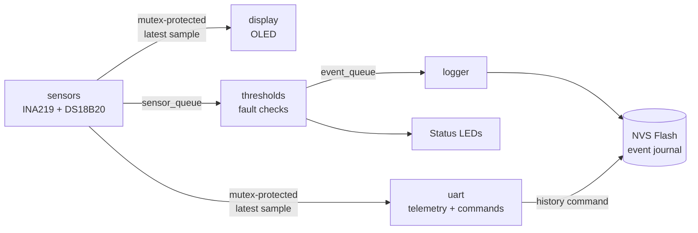

# Smart Sensor & Power Monitor

Prototype of a universal embedded module for monitoring the power and
state of a small electronic system. Built on **ESP32** with **ESP-IDF and
FreeRTOS**, it measures voltage, current and temperature, calculates power
and accumulated energy, raises a warning when thresholds are exceeded,
keeps an event journal in Flash and streams telemetry to a host PC and OLED display.

## About the project

This is **Case 1.5** from Engineering Project Sprint 2026, developed by a
team of five. My part was the firmware.

The goal of the case was a working prototype (a board or a breadboard
stand) with a microcontroller, sensors, a communication interface and
baseline firmware, together with a schematic, a BOM, a PCB concept and a
plan for moving to a production revision. The brief suggested an
STM32F1xx-based design as an example; we implemented it on ESP32

## Why ESP32

The brief suggested STM32F1xx as an example platform. We chose ESP32 for
these reasons:

- **Familiar toolchain.** I already had hands-on experience with ESP-IDF
  and FreeRTOS, which mattered with only two days available: no time was
  spent learning a new framework or RTOS.
- **Wi-Fi on board.** We planned to stream telemetry to a phone over
  Wi-Fi. It was dropped due to the time limit, but the hardware already
  supports it, so it remains a natural next step.
- **Enough resources for the task.** Dual-core MCU with built-in Flash
  that covers the event journal requirement (>= 100 records) without any
  external memory, which also simplified the PCB.

<p align="center">
  
</p>
<p align="center"><em>Prototype on a perfboard: ESP32 DevKit, INA219, SH1106 OLED, two DS18B20 and status LEDs.</em></p>

## Code structure

| File | Purpose |
|------|---------|
| `main/main.c` | `app_main`: initialisation and task creation |
| `main/config.h` | Pins, sampling rate, thresholds, log size |
| `main/types.h` | Shared data structures |
| `main/hardware.c`, `hardware.h` | Init and access to INA219, DS18B20, SH1106 (LVGL) and LEDs |
| `main/tasks.c`, `tasks.h` | FreeRTOS tasks: sensors, thresholds, logger, UART, display |
| `main/event_log.c`, `event_log.h` | Event journal in Flash |
| `main/idf_component.yml` | External dependencies |

## Features

- **Measurement:** bus voltage, current and power from an INA219 over I²C, and temperature from two DS18B20 sensors over 1-Wire.
- **Fault detection:** values are compared with configurable thresholds on a violation the firmware raises a warning and switches the status LED.
- **Event journal:** warnings are stored with a timestamp in the ESP32's on-chip Flash, up to 200 records.
- **Local display:** live voltage, current, power and the temperature of both sensors on an SH1106 OLED, drawn with LVGL.
## Telemetry format

Each sample is printed as one line:

| timestamp_ms | voltage_V | current_mA | power_mW | temp_right_C | temp_left_C |
|---|---|---|---|---|---|

```
36291      |      4.990 |        44.04 |     219.73 |     22.44 |     24.19
37291      |      4.990 |        43.49 |     216.06 |     22.44 |     24.19
```

## Dependencies

Built with **ESP-IDF v6.1**

All device drivers are third-party components. They are declared in
`main/idf_component.yml` and downloaded automatically by the IDF Component
Manager during the first build, so nothing needs to be installed by hand.
The application logic in `main/` (tasks, thresholds, event journal,
telemetry) is my own code.

| Component | Version | Used for |
|-----------|---------|----------|
| [`tny-robotics/ina219-esp-idf`](https://components.espressif.com/components/tny-robotics/ina219-esp-idf) | 1.0.0 | INA219 voltage/current sensor (I²C) |
| [`tny-robotics/sh1106-esp-idf`](https://components.espressif.com/components/tny-robotics/sh1106-esp-idf) | 1.0.2 | SH1106 OLED driver |
| [`espressif/ds18b20`](https://components.espressif.com/components/espressif/ds18b20) | 0.4.0 | DS18B20 temperature sensors |
| [`espressif/onewire_bus`](https://components.espressif.com/components/espressif/onewire_bus) | 1.1.2 | 1-Wire bus for DS18B20 |
| [`lvgl/lvgl`](https://components.espressif.com/components/lvgl/lvgl) | 8.4.0 | Graphics library for the OLED |
| [`espressif/esp_lvgl_port`](https://components.espressif.com/components/espressif/esp_lvgl_port) | 1.4.0 | LVGL integration for ESP-IDF |

Each component keeps its own license; see the component pages above.

## Build and flash

Requires ESP-IDF v6.1 with the environment set up (`. $IDF_PATH/export.sh`).

```bash
idf.py set-target esp32
idf.py build
idf.py -p <PORT> flash monitor
```
## Architecture

The firmware runs five FreeRTOS tasks. Data flows in one direction: the
`sensors` task samples the hardware, and everything else consumes its output.



### Tasks

| Task | Priority | Stack | Responsibility |
|------|----------|-------|----------------|
| `sensors` | 5 | 4096 | Reads INA219 (voltage, current, power) with a fixed period (`vTaskDelayUntil`), reads both DS18B20 sensors at a slower period, publishes every sample |
| `thresholds` | 4 | 3072 | Checks each sample for over-current, over-voltage, under-voltage and over-temperature; drives the status LEDs; emits an event when a fault starts |
| `logger` | 4 | 4096 | Writes a boot record with the reset reason, then stores every event from the queue in the journal |
| `uart` | 3 | 4096 | Command line over UART; streams telemetry while streaming is on |
| `display` | 2 | 4096 | Redraws the OLED with the latest sample |

Sampling and fault detection have the highest priorities, the display the lowest.

### Data exchange

- **Latest-sample snapshot:** a shared `telemetry_data_t` protected by a mutex. `sensors` writes it; `display` and `uart` copy it under the mutex and do all formatting and drawing outside the critical section.
- **`sensor_queue`** (10 samples): `sensors` -> `thresholds`. Every sample is checked. The sender uses a zero timeout, so a slow consumer can never block sampling.
- **`event_queue`** (20 events): `thresholds` -> `logger`. Flash writes are slow, so they are kept out of the sampling and fault-detection path.

### Design notes

- **Integer units in shared data:** mV, µA, µW and temperature × 100. Conversion to floating point happens only when printing.
- **Non-blocking temperature reads:** a DS18B20 conversion takes time, so the task only triggers it and collects the result on the next temperature period instead of waiting.
- **Edge-triggered events:** an event is recorded once when a fault begins, not on every sample while it lasts. The flag is cleared when the value returns to normal.
- **Reset reason in the journal:** every boot adds a record with the reset reason (power-on, software, panic, watchdog, brownout), which helps with diagnosing unexpected restarts.

## Event journal

Each record contains a timestamp (ms since boot), an event type and a value:

| Event | Value |
|-------|-------|
| `RESET` | reset reason |
| `OVER_CURRENT` | mA |
| `OVER_VOLTAGE`, `UNDER_VOLTAGE` | mV |
| `OVER_TEMP` | °C |

Records are kept in a ring buffer of `EVENT_LOG_MAX` entries. The whole buffer is stored as one blob in NVS (namespace `monitor`, key `events`) and committed after every event, so the journal survives reboots and power loss. On startup the blob is validated (size, record count, head index) and cleared if it is invalid. Access is protected by a mutex.

## UART commands

| Command | Action |
|---------|--------|
| `history` | Print the event journal |
| `stream on` | Start printing telemetry (see format above) |
| `stream off` | Stop printing telemetry |
