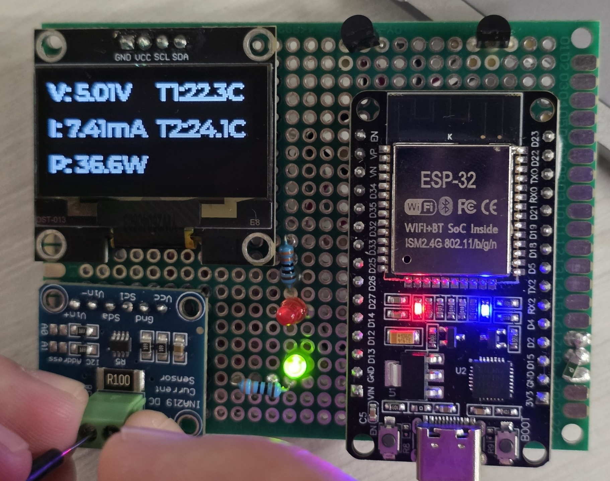

# Smart Sensor & Power Monitor

Prototype of a universal embedded module for monitoring the power and
state of a small electronic system. Built on **ESP32** with **ESP-IDF and
FreeRTOS**, it measures voltage, current and temperature, calculates power
and accumulated energy, raises a warning when thresholds are exceeded,
keeps an event journal in Flash and streams telemetry to a host PC and OLED display.

## About the project

This is **Case 1.5** from Engineering Project Sprint 2026, developed by a
team of five. My part was the firmware.

The goal of the case was a working prototype (a board or a breadboard
stand) with a microcontroller, sensors, a communication interface and
baseline firmware, together with a schematic, a BOM, a PCB concept and a
plan for moving to a production revision. The brief suggested an
STM32F1xx-based design as an example; we implemented it on ESP32

## Why ESP32

The brief suggested STM32F1xx as an example platform. We chose ESP32 for
these reasons:

- **Familiar toolchain.** I already had hands-on experience with ESP-IDF
  and FreeRTOS, which mattered with only two days available: no time was
  spent learning a new framework or RTOS.
- **Wi-Fi on board.** We planned to stream telemetry to a phone over
  Wi-Fi. It was dropped due to the time limit, but the hardware already
  supports it, so it remains a natural next step.
- **Enough resources for the task.** Dual-core MCU with built-in Flash
  that covers the event journal requirement (>= 100 records) without any
  external memory, which also simplified the PCB.

<p align="center">
  
</p>
<p align="center"><em>Prototype on a perfboard: ESP32 DevKit, INA219, SH1106 OLED, two DS18B20 and status LEDs.</em></p>

## Code structure

| File | Purpose |
|------|---------|
| `main/main.c` | `app_main`: initialisation and task creation |
| `main/config.h` | Pins, sampling rate, thresholds, log size |
| `main/types.h` | Shared data structures |
| `main/hardware.c`, `hardware.h` | Init and access to INA219, DS18B20, SH1106 (LVGL) and LEDs |
| `main/tasks.c`, `tasks.h` | FreeRTOS tasks: sensors, thresholds, logger, UART, display |
| `main/event_log.c`, `event_log.h` | Event journal in Flash |
| `main/idf_component.yml` | External dependencies |

## Features

- **Measurement:** bus voltage, current and power from an INA219 over I²C, and temperature from two DS18B20 sensors over 1-Wire.
- **Fault detection:** values are compared with configurable thresholds on a violation the firmware raises a warning and switches the status LED.
- **Event journal:** warnings are stored with a timestamp in the ESP32's on-chip Flash, up to 200 records.
- **Local display:** live voltage, current, power and the temperature of both sensors on an SH1106 OLED, drawn with LVGL.
## Telemetry format

Each sample is printed as one line:

| timestamp_ms | voltage_V | current_mA | power_mW | temp_right_C | temp_left_C |
|---|---|---|---|---|---|

```
36291      |      4.990 |        44.04 |     219.73 |     22.44 |     24.19
37291      |      4.990 |        43.49 |     216.06 |     22.44 |     24.19
```
